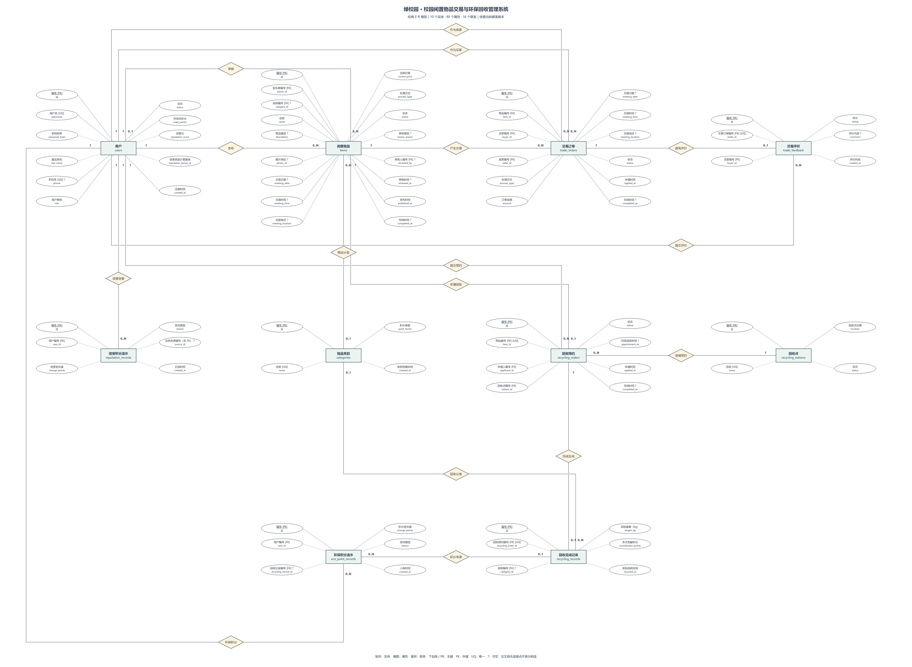
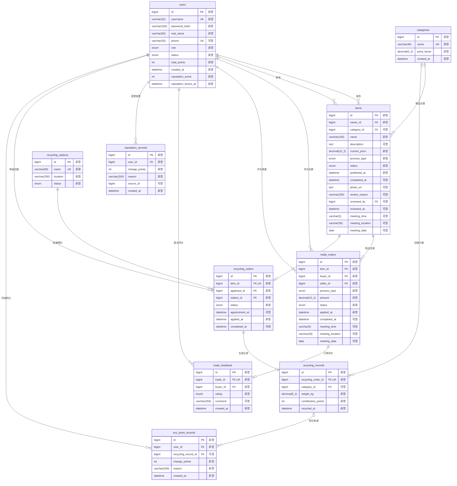

# E-R 图

本图依据当前 MySQL `campus_recycle` 的实际结构核对生成：10张业务表、82个字段、16条物理外键。已删除的6个字段不在图中；备份表不作为业务实体。

高清图：[PNG](report/er-chen-final.png) · [SVG](report/er-chen-final.svg) · [可编辑 draw.io](report/er-chen-final.drawio)

## 关系与基数

`PK` 为主键，`FK` 为外键，`UQ` 为单列唯一，`?` 表示可空。连线端点标注该端记录数；0..N表示零到多条。交易交接日期使用 `meeting_date DATE`。旧星期值已存入备份表，不属于业务实体。

| 关联父表 | 子表及外键 | 父端基数 | 子端基数 | 含义 |
| --- | --- | --- | --- | --- |
| `users` | `items.owner_id` | 1 | 0..N | 发布 |
| `users` | `items.reviewed_by` | 0..1 | 0..N | 审核 |
| `categories` | `items.category_id` | 0..1 | 0..N | 物品分类 |
| `items` | `trade_orders.item_id` | 1 | 0..N | 物品交易 |
| `users` | `trade_orders.buyer_id` | 1 | 0..N | 作为买家 |
| `users` | `trade_orders.seller_id` | 1 | 0..N | 作为卖家 |
| `users` | `trade_feedback.buyer_id` | 1 | 0..N | 提交评价 |
| `trade_orders` | `trade_feedback.trade_id` | 1 | 0..1 | 订单评价 |
| `users` | `reputation_records.user_id` | 1 | 0..N | 信誉变更 |
| `users` | `recycling_orders.applicant_id` | 1 | 0..N | 申请回收 |
| `items` | `recycling_orders.item_id` | 1 | 0..1 | 物品预约 |
| `recycling_stations` | `recycling_orders.station_id` | 1 | 0..N | 承接预约 |
| `recycling_orders` | `recycling_records.recycling_order_id` | 1 | 0..1 | 生成记录 |
| `categories` | `recycling_records.category_id` | 0..1 | 0..N | 回收分类 |
| `recycling_records` | `eco_point_records.recycling_record_id` | 0..1 | 0..N | 积分来源 |
| `users` | `eco_point_records.user_id` | 1 | 0..N | 环保积分 |

## Mermaid 源图

## 与业务流程的区别

- 物品与交易订单在数据库中是1对多，申请取消后可保留历史订单；业务代码只允许当前有效申请占用物品。
- 物品与回收预约、回收预约与完成记录、交易订单与评价，因子表外键有唯一约束，均为1对0..1。
- 环保积分流水的 `recycling_record_id` 可空且没有唯一约束，因此数据库是可选关联的一对多；不能因为当前完成流程只写一条流水就画成一对一。
- `reviewed_by` 关联用户表，由后端保证该用户是管理员；管理员是用户角色，不单建管理员实体。
- `source_id` 可来源于不同业务，没有统一外键，不画成物理关联。
- 类别和交易评价有表与后端用途，但页面入口仍不完整；E-R图表达数据库结构，并不表示全部页面功能已实现。
