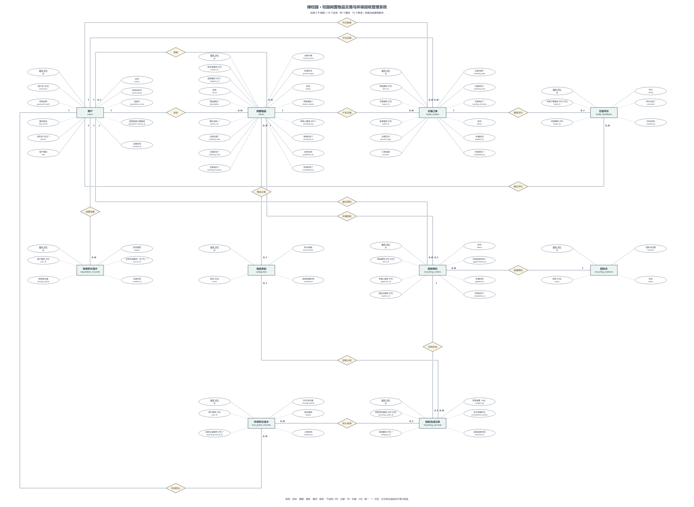

# E-R 图

最终图以 `database/schema.sql` 为结构基准，包含 **10 个实体、80 个属性、16 条外键联系**。本轮为源码与图文一致性核对，不代表已实时读取验收数据库。备份表不作为业务实体。

[Draw.io 可编辑文件](report/er-chen-final.drawio) · [高清 PNG](report/er-chen-final.png) · [SVG 矢量图](report/er-chen-final.svg) · [联系总览](report/er-chen-relations.png)

## 图形与符号

实体用矩形、属性用独立椭圆、联系用菱形，属性不放入实体框。主键以属性名下划线表示；`FK` 为外键，`UQ` 为单列唯一，`?` 表示可空。连线端点表示该端实体参与一次联系的数量，`0..N` 表示零到多条。

Draw.io 文件包含 12 页：完整 E-R 图、联系总览、10 张实体属性分图。完整图适合放大展示；答辩解释字段时使用对应分图。

## 实体与属性分图

| 实体 | 表名 | 属性数 | 全部属性分图 |
| --- | --- | ---: | --- |
| 用户 | `users` | 11 | [用户](report/er-chen-details/er-chen-users.png) |
| 物品类别 | `categories` | 4 | [物品类别](report/er-chen-details/er-chen-categories.png) |
| 闲置物品 | `items` | 17 | [闲置物品](report/er-chen-details/er-chen-items.png) |
| 交易订单 | `trade_orders` | 12 | [交易订单](report/er-chen-details/er-chen-trade_orders.png) |
| 回收点 | `recycling_stations` | 4 | [回收点](report/er-chen-details/er-chen-recycling_stations.png) |
| 回收预约 | `recycling_orders` | 8 | [回收预约](report/er-chen-details/er-chen-recycling_orders.png) |
| 回收完成记录 | `recycling_records` | 6 | [回收完成记录](report/er-chen-details/er-chen-recycling_records.png) |
| 信誉积分流水 | `reputation_records` | 6 | [信誉积分流水](report/er-chen-details/er-chen-reputation_records.png) |
| 交易评价 | `trade_feedback` | 6 | [交易评价](report/er-chen-details/er-chen-trade_feedback.png) |
| 环保积分流水 | `eco_point_records` | 6 | [环保积分流水](report/er-chen-details/er-chen-eco_point_records.png) |

字段类型、全部属性和约束见 [数据库逻辑结构](04-数据库逻辑结构.md)，字段用途及冗余判断见 [数据库字段用途核对](13-数据库字段用途核对.md)。

## 联系与基数

| 关联父表 | 子表及外键 | 父端基数 | 子端基数 | 含义 |
| --- | --- | --- | --- | --- |
| `users` | `items.owner_id` | 1 | 0..N | 发布 |
| `users` | `items.reviewed_by` | 0..1 | 0..N | 审核 |
| `categories` | `items.category_id` | 0..1 | 0..N | 物品分类 |
| `items` | `trade_orders.item_id` | 1 | 0..N | 物品交易 |
| `users` | `trade_orders.buyer_id` | 1 | 0..N | 作为买家 |
| `users` | `trade_orders.seller_id` | 1 | 0..N | 作为卖家 |
| `users` | `trade_feedback.buyer_id` | 1 | 0..N | 提交评价 |
| `trade_orders` | `trade_feedback.trade_id` | 1 | 0..1 | 订单评价 |
| `users` | `reputation_records.user_id` | 1 | 0..N | 信誉变更 |
| `users` | `recycling_orders.applicant_id` | 1 | 0..N | 申请回收 |
| `items` | `recycling_orders.item_id` | 1 | 0..1 | 物品预约 |
| `recycling_stations` | `recycling_orders.station_id` | 1 | 0..N | 承接预约 |
| `recycling_orders` | `recycling_records.recycling_order_id` | 1 | 0..1 | 生成记录 |
| `categories` | `recycling_records.category_id` | 0..1 | 0..N | 回收分类 |
| `recycling_records` | `eco_point_records.recycling_record_id` | 0..1 | 0..N | 积分来源 |
| `users` | `eco_point_records.user_id` | 1 | 0..N | 环保积分 |

## 约束与业务解释

- 物品与交易订单是 1 对多，取消后保留历史订单；当前有效申请的互斥由事务、物品行锁和状态复查实现。
- 物品与回收预约、回收预约与完成记录、交易订单与评价，均由子表外键的唯一约束限制为 1 对 0..1。取消后重新预约复用原预约记录。
- `eco_point_records.recycling_record_id` 可空且不唯一，回收记录与积分流水不能画成一对一。当前正积分完成流程写一条流水，零积分不写流水。
- 管理员是用户角色。`reviewed_by` 关联 `users.id`，后端另行校验审核人的管理员身份。
- `reputation_records.source_id` 不是外键：审核驳回时保存物品编号，交易评价时保存交易订单编号。图中不为其添加物理外键连线。
- 新发布和编辑要求选择类别；数据库保留可空类别以兼容历史未分类数据。评价页面已支持提交、查看评分和内容，提交后订单状态为 `REVIEWED`。

## 多对多联系的实现

用户与可申请物品的交易参与关系通过关联实体 `trade_orders` 实现，保存买家、卖家、物品、金额和交易安排。用户与回收点的预约参与关系通过 `recycling_orders` 实现，保存申请人、物品、回收点和预约时间；不再增加重复关联表。

## 布局

完整图采用三层布局：上层从左至右为用户、物品、交易订单、交易评价；中层为信誉流水、类别、回收预约、回收点；下层为环保积分流水和回收完成记录。属性分别环绕所属实体，联系在实体之间引出；联系总览和实体分图用于分开展示密集连线。
